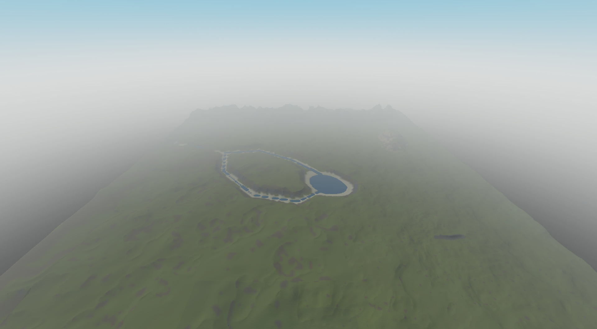
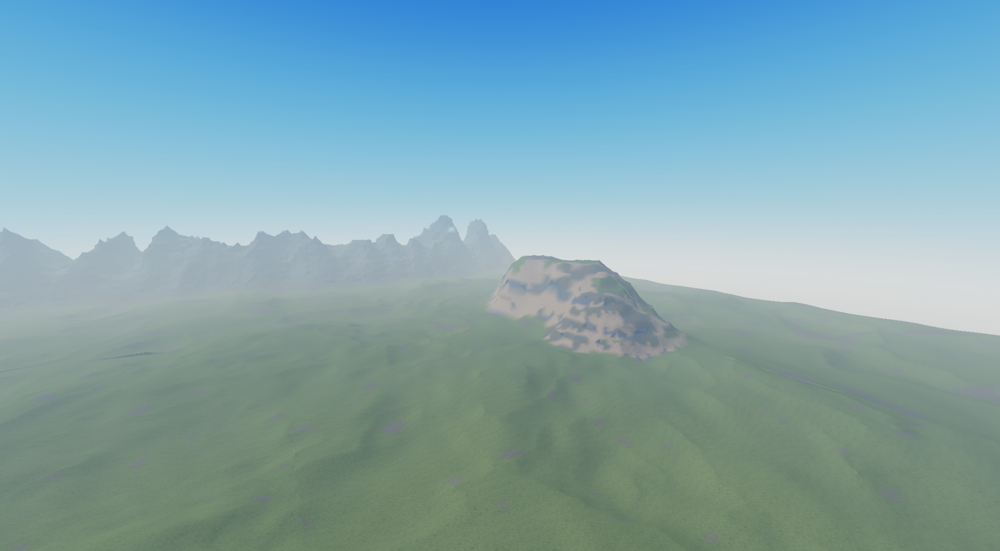
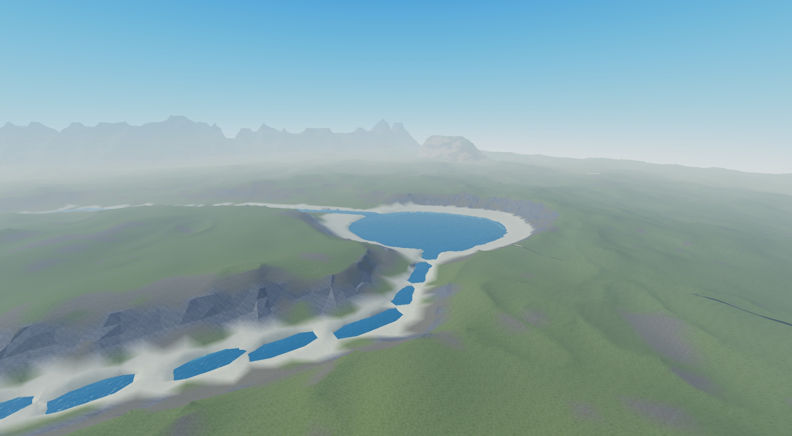

# roblox-agents

Specialized [Claude Code](https://code.claude.com/docs) agents and skills for Roblox development, distributed as a plugin marketplace.

| Plugin | Agent | What it does |
|---|---|---|
| `roblox-world` | `world` | Creates a world in Roblox Studio, edits it and recovers its context, through the engine it ships with |

The map is always the output of a program: the agent changes a declared World Plan and runs the engine, instead of shaping terrain by hand. Terrain is generated in Studio and saved in the place, so players get static terrain.

## Example

A test world made by the agent: 36 Chunks with hills, a range, a mesa, a River with a fork, and a Lake where they end. These are raw captures from Studio on 2026-11-06, with no hand edits, so they show the current state of the look and not a finished one. The whole map appears through Studio's fog.



Each change is a change to the World Plan. Moving the mesa closer to the range took one line of the plan, and the engine wrote only the 8 Chunks it touched, in 3.7 seconds.





Known defects are in the [issues](https://github.com/sayee-444/roblox-agents/issues), such as [a cave left open](docs/bugs/open-cave.md) when the ground over it moves.

## Requirements

- Claude Code.
- [Roblox Studio MCP](https://create.roblox.com/docs/studio/mcp), with the server registered under the name `Roblox_Studio`, because the agent's tool list and the guard depend on that name. A server added with local scope exists only in its own project, so add it at user scope to reach every project. On Windows:

  ```text
  claude mcp add --scope user Roblox_Studio -- cmd.exe /c "cd /d %LOCALAPPDATA%\Roblox && .\mcp.bat"
  ```

- Windows, for the guard hook and the engine's command line. Neither has been tested elsewhere, and where `powershell.exe` is missing the guard blocks nothing.

## Install

```text
claude plugin marketplace add sayee-444/roblox-agents
claude plugin install roblox-world@roblox-agents
```

Then start it from your project folder:

```text
claude --agent roblox-world:world --model sonnet
```

On its first task in a project, the agent asks about your map and writes `docs/world/rules.md`. A new world needs only a World Plan, because the plugin includes the Generator engine. Installing from the marketplace has not been tested yet: every measured run loaded the plugin from a checkout.

## What it can do

[`docs/functions.md`](docs/functions.md) lists every function by job, what to ask for and whether it has been measured.

| Job | Ask for | Mainly runs |
|---|---|---|
| Create | A new world with these Landforms | `new`, then `run` |
| Edit | Add, change, remove or restore something | `generate <i> <j>` and `world-history` |
| Recover context | What exists, what changed and why | `describe` and `docs/world/history.md` |
| Check | Debug | `world-debug`, starting from `check` |
| Look | A capture of this view | `capture <view>`, only on request |

The agent needs your explicit order to publish to Roblox, overwrite a hand-edited Chunk, change the World Seed or delete all terrain. Saving the place is always yours, because no tool lets it save.

## Engine commands

The agent drives the Generator through `node <engine>/tools/world.js <command>`. Each command needs no model and gives the same result each time, and `help` lists them with their flags.

| Command | Does |
|---|---|
| `status` | What the plan holds, which Chunks exist, the last change and the places open. Works with Studio closed |
| `new <dir>` | Starts a world. With `--landforms range,mesa,river,fork` it composes the whole World Plan |
| `run` | The whole cycle: `sync`, `test`, `describe`, generate every Chunk, `verify` and `heights` |
| `generate <i> <j> ...` | Writes only the Chunks a change touched |
| `remove <id>` | Takes a Landform, River or Lake out of the plan and rewrites only the Chunks it touched |
| `scale <factor>` | Rewrites the World Plan at a new size, keeping its seeds |
| `verify <i> <j>` | Rewrites one Chunk and proves the result is identical |
| `borders` | Compares the voxels on both sides of each Chunk border. Slow |
| `describe` | Validates the plan and lists what exists and which Chunks each thing touches |
| `height <x> <z>`, `heights` | The surface at one spot, and how high each Landform is and how deep each River and Lake got |
| `capture <view>`, `shot` | Saves views from Studio. These move the camera |
| `wipe` | Alone, prints what would be lost. Confirmed, deletes all terrain |

## World Plan parameters

The World Plan declares what exists where, and the seeds fill in the detail. The [template](plugins/roblox-world/engine/templates/plan.luau) carries a comment on each field, and `describe` refuses a plan with a field out of range. Lengths and heights are in studs.

### The whole world

| Field | Affects |
|---|---|
| `worldSeed` | Every detail the plan leaves to chance. Changing it is the developer's order |
| `extent` | Which Chunks exist, as inclusive indices. Each Chunk is `chunkSize` studs, 512 |
| `floorY` | Where ground stops. It goes lower only under deep water or a cave, with `rockUnder` studs of rock under them, 16 by default |
| `base` | The gentle hills everywhere: `mean` height, `amp` amplitude, `scale` feature size, `octaves`, and a domain warp of `warpAmp` studs at `warpScale` |
| `materials` | Where snow, rock and sand go: `snowLine`, `rockLine`, `steep` for bare rock, `bankDist` for the sand band along a River, and `bedSand` and `bedDeep` for a bed that turns from sand to earth and rock as the water deepens |

### Landforms

| Kind | Fields | Affects |
|---|---|---|
| `mountain` | `points`, `halfWidth`, `height`, `ridgeScale`, `crestScale` | A range along a crest line. `halfWidth` includes the blend margin, so nothing of it reaches further |
| `mesa` | `center`, `radius`, `margin`, `levels`, `height`, `warp`, `elongate`, `angle`, `gully` | A flat top of `radius` with a stepped flank `margin` wide in `levels` steps. `warp` shifts the outline, `elongate` and `angle` stretch and turn it, and `gully` bites into the flank |
| `valley` | `riverId`, `halfWidth`, `floorY`, `sides` | The valley a River runs through. `sides`, from 0.02 to 1.5, is how steep it comes down to the water: 0.1 a plain, 0.3 medium, 0.8 a mountain valley. It can take one value per point of its River |
| `cave` | `points` of `{ x, y, z }`, `radius` | A tunnel of `radius` along a path. The template says how high to place its points from what `height` reports |

### Water

Water has the most generation functions. Its shape comes from the plan, and the ground around it decides how deep it gets: under `banks`, the ground keeps the slope it comes down with across the waterline and curves into a deepest line, so steep ground gives deep water and a plain gives shallow water ([ADR 0010](docs/adr/0010-slope-decides-water-depth.md)). A depth in the plan is the most the water may reach, and `heights` reports the depth reached.

**A River's route and width**

| Field | Affects |
|---|---|
| `points` | The route, from one edge of the map to the other. A fork is another River whose first point is one of this River's points |
| `curve` | 0 follows straight legs between the points, 1 a smooth curve through them |
| `meander` | The largest swing away from that line. It fades to nothing at each point |
| `halfWidth` or `widths` | One half width, or one per point, changing gradually between them |
| `bendWiden` | How much a bend widens: this fraction at 90 degrees, less at gentler bends. Each bend also gets a steep, deep Cut Bank outside and a sandy Point Bar inside |
| `loops` | A bend close to a circle on one leg: `leg`, `radius`, `turn` up to 360 (180 a semicircle, 290 leaves a neck, 360 closes with an island) and `side`. It needs a `curve` above 0 |
| `waterLevel` | The constant level of the still water, a multiple of 4 |

**A River's depth**

| Field | Affects |
|---|---|
| `bedY` or `depths` | The bed's height, or one depth under the water per point, changing gradually between them. With `banks`, the most it may reach: a River gets about half its valley's `sides` times its half width, and never less than 8 studs unless it asks for less |
| `depthVary` | Pools and shallows along the line, as a fraction of the depth, from 0 to 0.9 |
| `bedRough` | Swells of the bed, below the shallowest depth |

**A Lake**

| Field | Affects |
|---|---|
| `center`, `radius`, `shore` | Where the water is, how far it reaches, and how far out the ground comes down to it |
| `warp`, `elongate`, `angle` | A shifted outline, stretched along one axis and turned |
| `bedY` | The bed's height. With `banks` it may be left out, and the Lake takes its depth from its size: a quarter of its radius up to radius 425, then growing as the natural log of the radius, up to `depthCap` ([ADR 0011](docs/adr/0011-a-lake-takes-its-depth-from-its-size.md)) |
| `depthCap` | The most a depth from size may reach: 220 by default, or `false` for no cap |
| `depthVary` | Pools and shallows across the bed, 0.4 by default for a depth from size. There they also lower the ceiling, so they show even on steep ground |
| `bedRough` | Swells of the bed, below its depth |
| `waterLevel` | The level of the water. Every River ending in the Lake must share it |

**Banks**: how a River or Lake meets the land, given as `banks = { ... }`. Without it, the older shape falls straight from a sand ledge.

| Field | Affects |
|---|---|
| `shore` | Studs of Shore beside a River's water, about half of it sand. A Lake uses its own `shore` field |
| `rough` | Small slopes under the water, which leave the waterline and the deepest line alone |
| `vary` | How much the slope and the shore change along each side of a River, or around a Lake, from 0 to 0.9 |
| `smooth` | Fills crests thinner than about twice this between two stretches of water, from 0 to 100. 0 turns it off |

## Skills

Each skill is a set of instructions the agent reads only when its task needs them.

| Skill | Holds |
|---|---|
| `world-generation` | The method: World Plan, Chunks, `describe`, hand edits and design decisions |
| `world-history` | The log of past map changes, and how to restore what was removed |
| `world-debug` | Debug mode, loaded when a check fails or when you ask for it |
| `terrain-techniques` | Recipes for complex Landforms, materials and Studio writes |
| `roblox-terrain-facts` | Engine limits, with sources |
| `world-project-setup` | How to create a project's world context |

## Where the agent keeps its context

| Place | Holds | Travels with |
|---|---|---|
| This plugin | The Generator engine, the method and verified engine facts | Every installation |
| The project's Git repository | The World Plan, its rules, its decisions and its map history | The project |

## Guard

While the plugin is enabled, a hook applies to the whole Claude Code session, including sessions outside this agent. It blocks agent attempts to publish a place and to run `rojo build`, `rojo upload` or `rojo syncback`, and it asks before a confirmed wipe. It catches mistakes, and it is not a security boundary.

## Working on this repository

| Command | Does |
|---|---|
| `node tools/check.js` | Every check a merge depends on |
| `node tools/benchmark.js cost` | Free measure of the plugin's context, with more in [`docs/benchmark.md`](docs/benchmark.md) |
| `node tools/measure-run.js <transcript.jsonl>` | Time, tokens and what a run actually did |

Pending work is in the [issues](https://github.com/sayee-444/roblox-agents/issues), what the agent can do in [`docs/functions.md`](docs/functions.md), the vocabulary in [`GLOSSARY.md`](GLOSSARY.md) and the recorded decisions in [`docs/adr/`](docs/adr/).

## License

[MIT](LICENSE).
