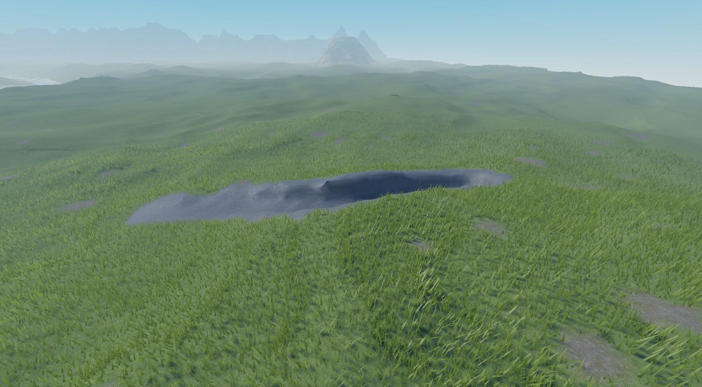

# A cave left open after the ground over it moves

Issue: [#22](https://github.com/sayee-444/roblox-agents/issues/22). Status: designed on 2026-11-06 in [#30](https://github.com/sayee-444/roblox-agents/issues/30), which decides what the options below only weighed. The developer says when to start.



The capture is from the developer's own camera, at (1169.55, 116.09, 1370.87), looking at (1178.43, 69.80, 1282.67).

## What happens

A cave stays declared in the World Plan after the ground that covered it moves away. `generate` then carves it in open ground, so it reads as a trench and not as a cave, and every check still passes.

This is not a rendering failure and no Chunk was left unwritten. The engine did what the plan says, and the plan no longer makes sense. Nothing checks whether a cave has a roof.

## Evidence

World `test-map-x2`, in `worlds/`. The agent moved the mesa, and was told to leave the cave in place.

| Field | Value |
|---|---|
| Mesa center, before | (1300, 1250), commit `91c542d` |
| Mesa center, after | (1300, -100), commit `34b70b6` |
| Cave points `{x, y, z}` | (1092, 60, 1250), (1130, 60, 1250), (1180, 60, 1262), (1240, 60, 1250) |
| Cave radius | 14, so its roof would be at y 74 and its floor at y 46 |
| Chunks the cave touches | 2,2 and 2,3 |
| Chunks the move wrote | 2,2 3,2 2,3 3,3 and 2,-1 3,-1 2,0 3,0 |

**Measured in Studio, with terrain rays on the generated map.** A ray cast upward from the cave's axis at y 60:

| Point | Roof found | First solid ground from above |
|---|---|---|
| (1092, 1250) | None | 48.5 |
| (1130, 1250) | None | 47.0 |
| (1180, 1262) | None | 47.2 |
| (1240, 1250) | None | 46.9 |

Along the whole axis, sampled about every 4 studs, 36 of 36 samples were open to the sky.

**Measured from the agent's run, with `height`:** the ground the plan declares is 46.9 at (1092, 1250), 60.4 at (1180, 1262) and 56.5 at (1240, 1250). All are below the roof the cave would need at y 74. `height` ignores the cave: at (1180, 1262) it says 60.4 while the carved floor is at 47.2. So the plan alone holds what a check needs, with no voxels to read.

**What the run reported:** `generate` wrote 8 Chunks and `borders` found 0 differences on 60 borders. No output mentioned the cave. The agent found the problem only because the prompt told it to report on the cave, so it read heights by itself, and it then described it wrongly: it said the mouth was still a tunnel, while the rays show no roof there either.

## Reproduce

The place used, Place1, was not saved and is no longer a test place, so the terrain must be generated again. In the existing world, with Studio open on a disposable place:

```text
cd worlds/test-map-x2
node <engine>/tools/world.js run --place <name> --project .
```

Then read the cave's axis with an upward ray, as above.

From nothing, in any world:

1. Declare a mesa and a cave whose axis runs inside its flank.
2. Run `run`.
3. Move the mesa's `center` far from the cave in the World Plan.
4. Run `generate <i> <j> ...` for the Chunks where it was and where it goes.

Expected: the engine reports that the cave has no cover. Actual: exit 0 and silence.

## Not verified

- Whether the cave was covered before the move. No measurement of that state exists.
- Whether a Landform other than a mesa causes the same, such as a range. The cause does not depend on the Landform, and this was read and not run.
- A character walking the trench.

## Options to weigh when this is treated

These are the developer's ideas and first thoughts on them, and nothing here is decided. The developer wants the script to catch this, to spend as few tokens as possible.

**Detect it in the engine.** Sample points along each cave's axis, and compare `Shape.height`, which ignores the cave, with the roof at `y + radius`. This needs no voxels and no model, so it costs no tokens until it fires. A cave's mouth is meant to be open, so the rule should forgive its ends and require cover along the rest. A minimum roof thickness and the share of the axis that must be covered need choosing, against a cave that is known to be good.

**Report it where the agent already reads.** `describe` and `heights` print on every `run`, and a line such as `cave: 36 of 36 samples without cover` costs little. Whether it fails the run is a choice: a failure stops `run`, as an invalid plan does, and a warning lets it finish and leaves the choice to the agent.

**Catch it before writing.** `Describe.impact` exists and no command reaches it (`docs/next-steps.md`). A check run on the plan before `generate` would warn before any terrain is written.

**Tell a mouth from a cave.** The developer's idea: a mouth and a cave are different parts, so a mouth has no roof to check, and a mouth with no cave connected to it is removed too. A mouth may be a wedge open to the sky, and a very short stretch of cave behind it is enough to keep it.

First thought: derive the parts from the terrain, with no new field in the plan, so that they stay right when the ground moves. Walk the axis from each end. The open stretch up to the first covered sample is a mouth, and the covered stretch after it is the cave.

| What the walk finds | Verdict |
|---|---|
| No covered stretch of the minimum length, as here with 36 of 36 samples open | No cave: report it, mouth included |
| A covered stretch, with a mouth of allowed length | A cave |
| A covered stretch, with a mouth longer than allowed | Report it, since the open part reads as a trench |
| An open stretch between two covered ones | Not decided: a skylight, or a break |

The minimum cave length and the maximum mouth length are unchosen, and need testing against what the developer judges good in Studio. Today's carving is a round tube, so a true wedge needs a change to the carving as well, and the check does not depend on it.

**What to do with the cave:**

| Choice | Weigh |
|---|---|
| Remove it and regenerate its Chunks | Simplest, and what the developer proposes. The agent's rules today say to start only work the developer asked for, so acting alone needs a change to those rules, and it may remove something wanted |
| Keep the shape as a new kind, such as a gully | A cave and a trench can share the carving code. A separate kind in the plan keeps "cave" meaning something covered, so that the check above stays simple. This is a new word for `GLOSSARY.md`. Reusing the kind `cave` for an open shape would make the check unable to tell a bug from a choice |
| Lower the cave, or add a hill over it | Keeps a real cave, and needs a choice per case |

**Record it.** A removal goes in `docs/world/history.md` like any change, through `world-history`: the Chunks written, a one-line reason and the block to restore. The World Plan then no longer names the cave, so the next session sees it through `describe` and the history.
