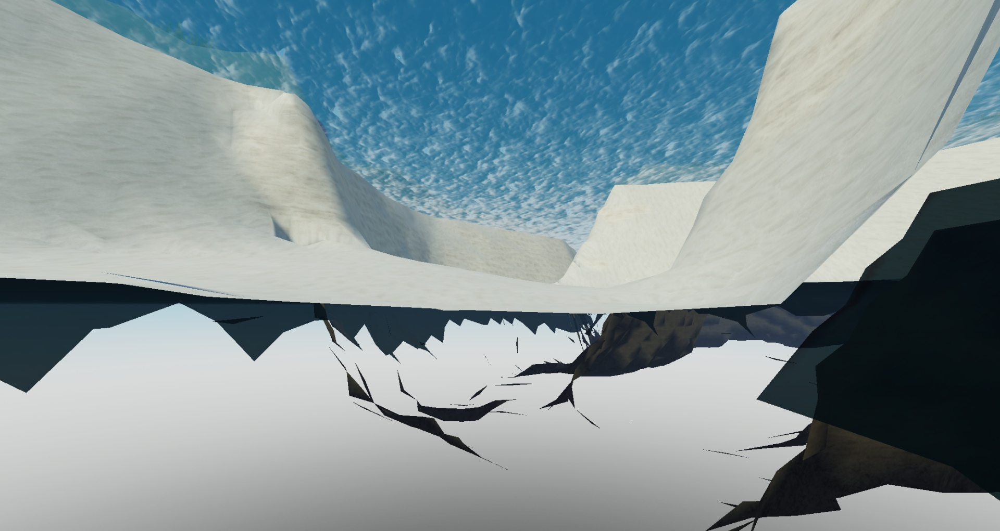

# Water depth does not read as an edited bed

Reported by the developer on 2026-11-07, on plugin 0.26.1, after #40. Their words, translated: "There is a depth, but the ground still looks like the original. It was not replaced, it was not edited." Their exact meaning is not settled, so ask them at the start, looking at this view.



## Where

World `test-map-x2`, in `worlds/`, in Place1. The developer's camera, read from Studio:

- **Position:** 66, -6, 197
- **Looking along:** 0.994, 0.105, 0.041, so east and slightly up, along the River inside its loop

Place1 may not have been saved. If this terrain is gone, run this from the repository root:

```text
node plugins/roblox-world/engine/tools/world.js generate --place Place1 --project worlds/test-map-x2
```

## What was measured

Voxels read from Studio along the view, with a column's lowest height for each material or water. `-` is air.

| Column | Rock from | Sand from | Water only from | Water ends |
|---|---|---|---|---|
| 40, 192 | 0 | 12 | none | none, ground ends at 28 |
| 64, 196 | -20 | -16 | 0 | 20 |
| 72, 196 | -28 | -24 | -8 | 20 |
| 120, 196 | -24 | -20 | -4 | 20 |
| 184, 200 | -16 | -12 | 8 | 20 |
| 208, 200 | 0 | none, Ground from 12 and Grass from 20 | none | none, ground ends at 28 |

- The plan gives ground of -3.1 at 66, 197, and -5.5 at 120, 199. The voxels agree, so the depth was written.
- The camera, at y -6, is inside the ground, under the bed.
- All air lies below each column's Rock. Nothing exists under about -28 here.

## What the view shows

From read and seen, not proven:

- The upper half shows sand banks and, above them, the underside of the water.
- The lower half shows the sky through the map, with dark jagged pieces. A camera inside solid terrain sees through it, and the rock under the bed is only 16 studs thick, so the empty space under the map is close.

## Possible causes, not tested

1. **Same material at every depth.** The bed is Sand from the bank to the deepest point, so a deep bed may look like the ground that was already there. `Materials.surface` chooses by distance to the River, and never by depth.
2. **Stale render.** No Play and Stop ran after the last `generate` and `regenerate`, and `docs/next-steps.md` records rendering that lags behind voxels. The dark pieces may be old mesh.
3. **Shape of the bed.** The bed is flat in its middle and rises to the bank through a smoothstep from 0.4 of the width, so a deep River may look like a sharp trench and not a natural bed.
4. **The view from below.** If the developer expected ground below the camera, the thin rock from ADR 0008 is what they are seeing, and `rockUnder` would be the setting to change.

## First steps

1. Ask the developer what they expected to see, and from which position, with the camera over the water if possible.
2. Press Play then Stop with `world.js refresh`, to rule out cause 2.
3. Write a failing test in the pure Generator for the agreed behaviour before changing anything.

## What the developer expected

Said on 2026-11-07, translated: the sand does not follow the bed, the ground from before the change sits above the new depth, and it would be good to have sand from a certain height, and with more depth a real bed with some sand, earth and gravel at the bottom.

## What was measured on 2026-11-07

On plugin 0.26.1, in Place1:

- **The old ground is not there.** A voxel read of 42 columns across the River, at x 72 and 120, found no solid above the bed where water lies, and 56 raycasts ignoring water hit the planned bed, down to -6.7.
- **The render was not holding old ground when looked at.** The first capture of the session already rebuilt the render, so the developer's state was not captured. A later write showed new materials in a capture about 1 s after `generate`, with no rebuild. So cause 2 is unlikely and not ruled out for a far camera.
- **Cause 1 was real.** The bed was Sand at every depth.

## The change

On plugin 0.27.0, `Materials.surface` takes the water level, and a bed chooses by the depth of its water: Sand under about 6 studs, then Ground coming through the Sand, and from about 14 studs Ground with patches of Rock and a little Sand. `bedSand` and `bedDeep` in the plan's `materials` move those depths. Roblox has no gravel terrain material. Cobblestone was tried first and looked like paving, so Rock stands in for it.

Not changed: the shape of the bed, cause 3, and the rock under it, cause 4. A camera inside the ground still sees through the map.

Not verified: whether this is what the developer meant by old ground. They judge the look on `test-map-x2`.
